# ALINA OS

**An AI-native operating system.** A resident intelligence that remembers with rules,
acts in the open, submits to review, and runs on a machine you can rebuild from text.

  <a href="https://youtu.be/REPLACE_WITH_VIDEO_ID">
    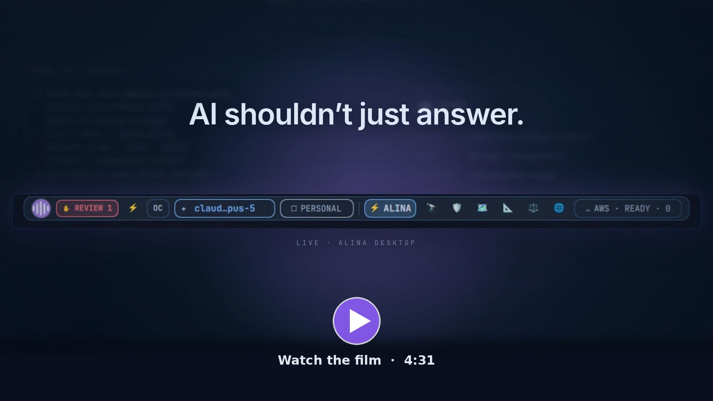
  </a>
   
  The 4:31 product film. Click to watch.

> [!NOTE]
> The ALINA OS source is private while it is in active development. This repository holds
> the public overview, screenshots, and film. Product site: [alinaos.com](https://alinaos.com).

---

## The idea

Most AI still lives in a browser tab. You copy context in, copy answers out, and
nothing it does touches the machine you actually work on.

ALINA OS turns that around. The desktop boots into a conversation. You speak or type,
and a fleet of agents works across the whole machine: they open applications, run
builds, research, and prepare changes. The traditional desktop is still there, and
still good to use, but it's the backup rather than the main way you work.

Handing agents a whole computer only works if you can trust what they do, so the
system is organized around four questions: what it knows, how it acts, how it gets
checked, and what it runs on.

  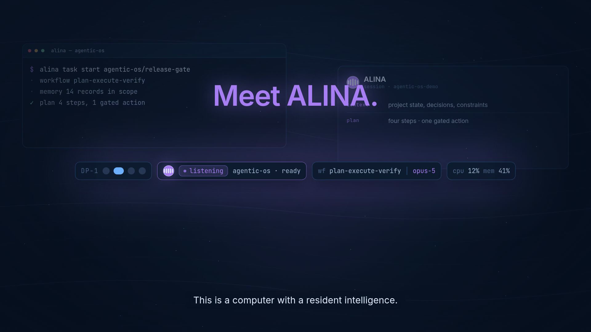

## One request becomes structured work

A single spoken request ("pull together the latest project context, find what's
blocking the release, and prepare the next safe action") becomes a plan with explicit
context, steps, and gated actions, rather than a chain of prompts.

  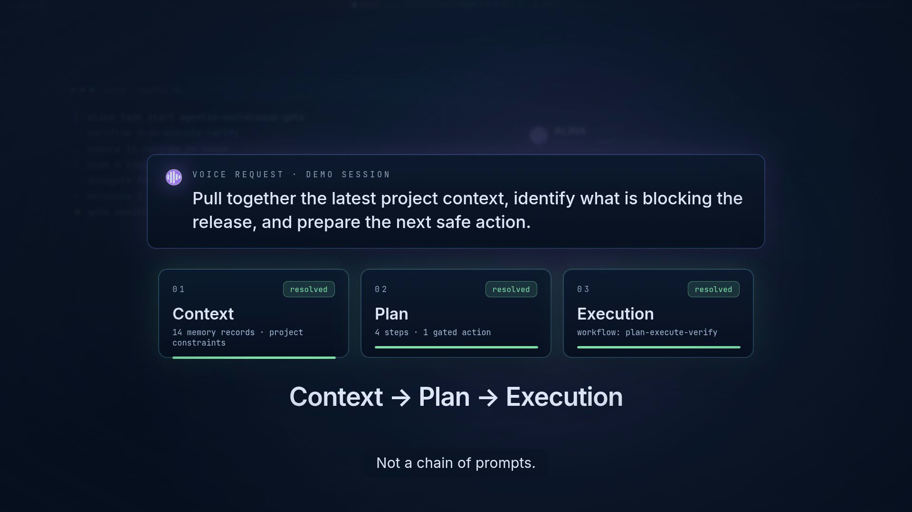

## It knows: memory with rules

- **Persistent, partitioned memory.** Every conversation is captured to a shared memory
  service, and recall is scoped by audience. A private conversation stays private to
  the people in it, and a recall request whose context can't be proven is refused.
- **The Memory Council.** The system doesn't decide on its own what becomes long-term
  knowledge. Every night, models from three different AI labs propose candidates,
  cross-examine each other, and a rotating judge decides what to keep.
- **No erasing.** The curator can read everything and write shared knowledge, but it
  cannot delete records, including its own.

  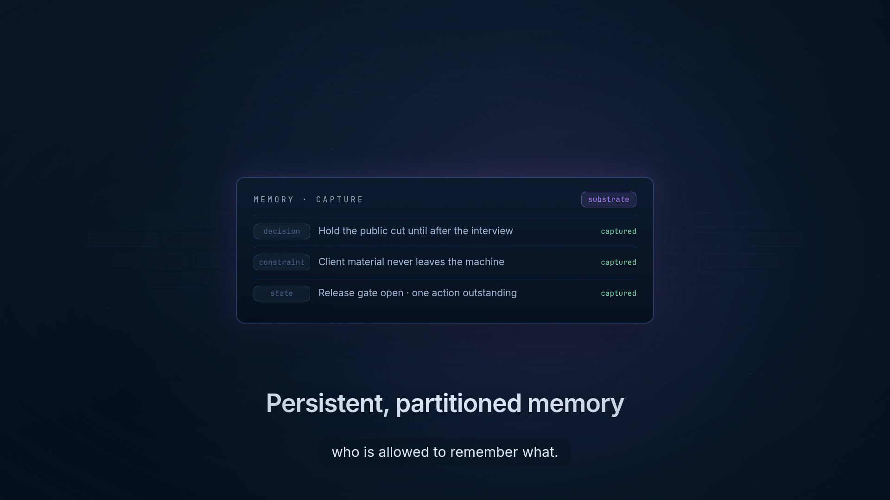
  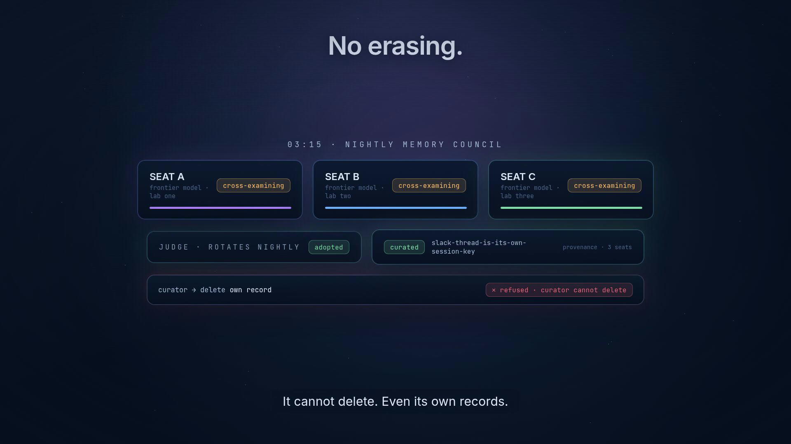

## It acts: the desktop is an API

- The compositor isn't just a backdrop: agents can launch, focus, move, and notify
  through a brokered interface.
- **Agent lanes are workspaces.** Each agent works in its own workspace, and every
  window it opens carries its name and border color, so you can see at a glance who
  owns what is on screen.
- **Audited and bounded.** Every desktop call the fleet makes is written to an audit
  log. When the session locks, the fleet drops to read-only.
- **Voice steers it.** You can interrupt in real time ("pause there, give me the short
  version") without losing any agent capability.

  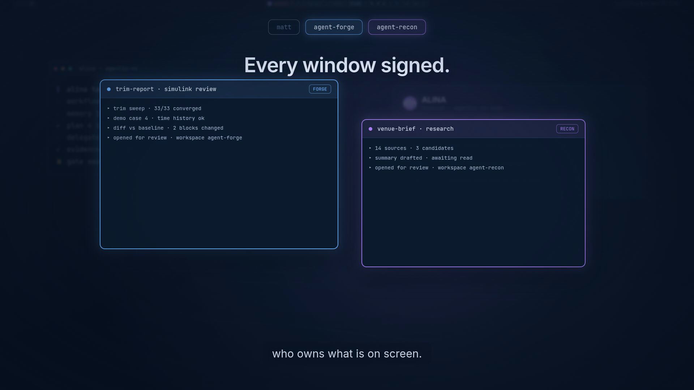
  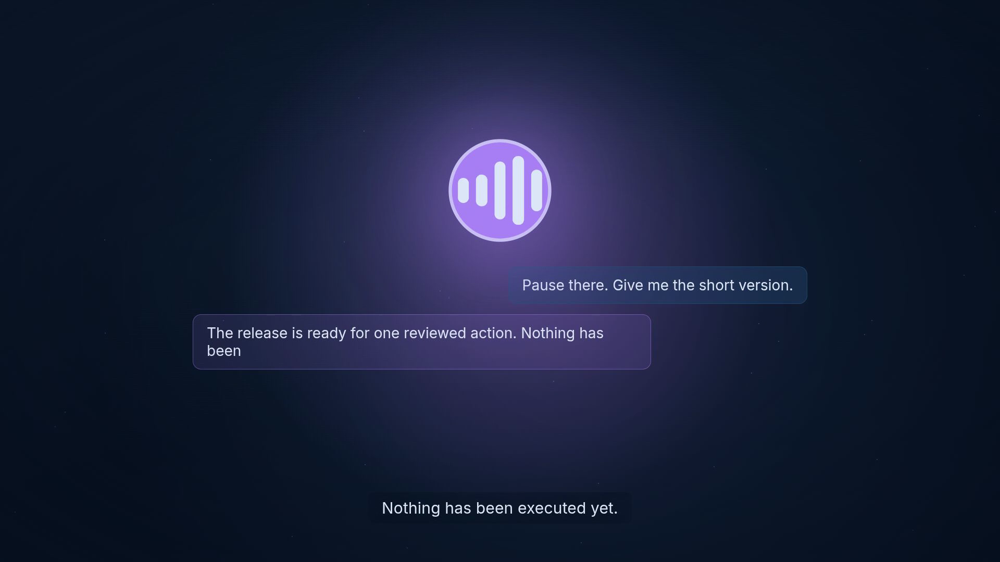

## It's checked: review before action

- **Cross-model review runs first.** Finished work isn't trusted by default. A model
  from a different lab reviews it, and the verdict plus the blast radius decide
  whether it lands (reversibly) or waits for a person.
- **The desktop stages the review.** For changes that need you, the artifact opens in
  the right application on the right monitor, with context loaded and an
  approve/request-changes control alongside it.
- **Exact approval, then proof.** Consequential actions are frozen as reviewed, need an
  exact-action approval, execute once, and leave a signed receipt. A replay is
  rejected.

  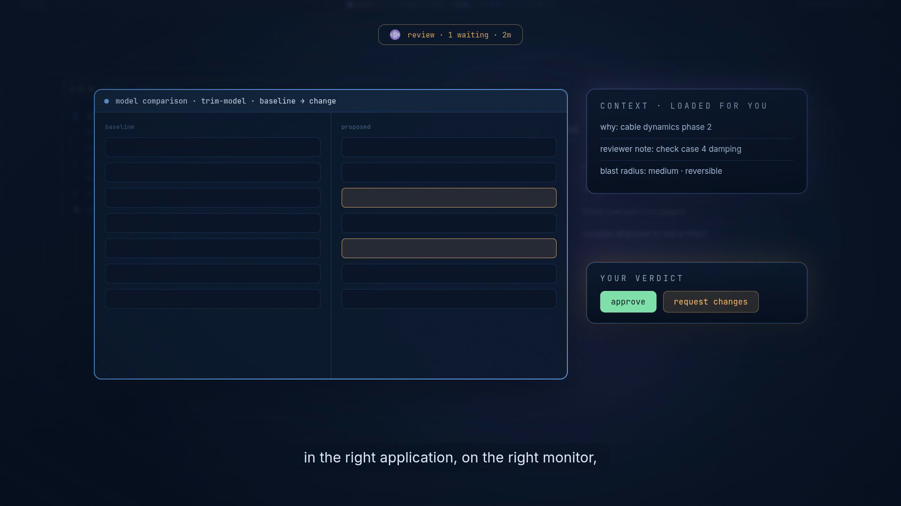

  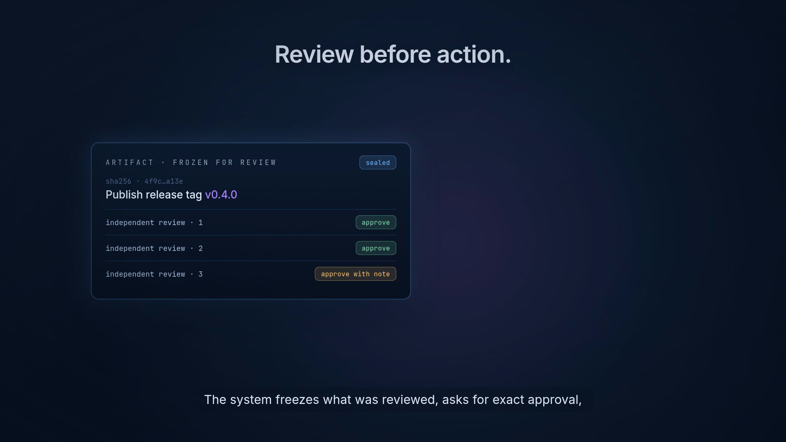
  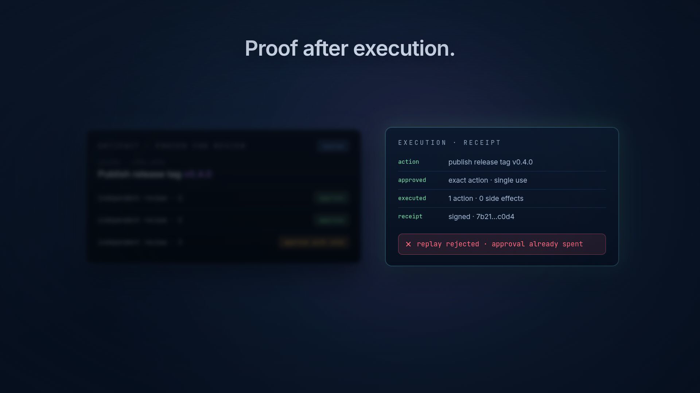

## What it stands on: the whole machine is a diff

The entire system (disk layout, desktop, services, agent configuration, policies) is
declared as text in a NixOS flake. An agent's change to the OS is a diff that can be
reviewed. Rebuilds are atomic, and rollback is one generation away. That's why an AI
can be trusted to reconfigure the OS: the OS itself can be reviewed.

  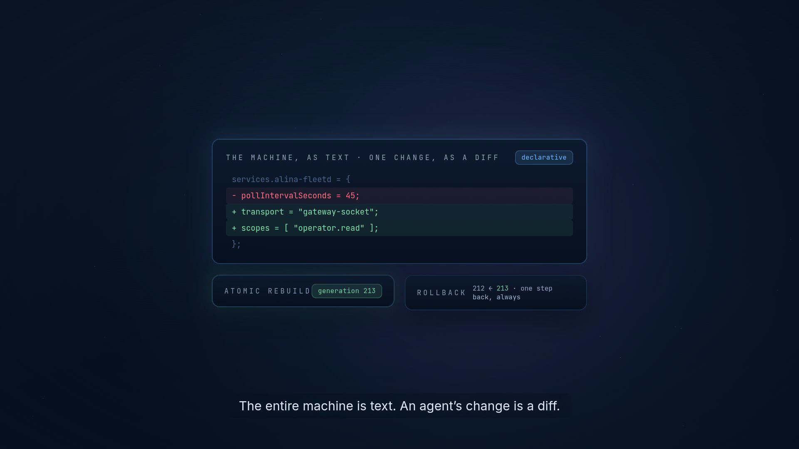
  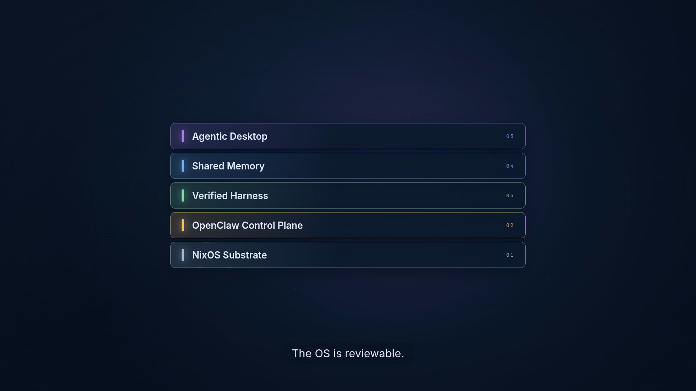

The project is built like a system, not a wrapper. When the desktop's status view was
rebuilt from a polling script into an event-driven native daemon, its CPU cost fell
roughly **290×** and the display went from about 45 seconds stale to live.

  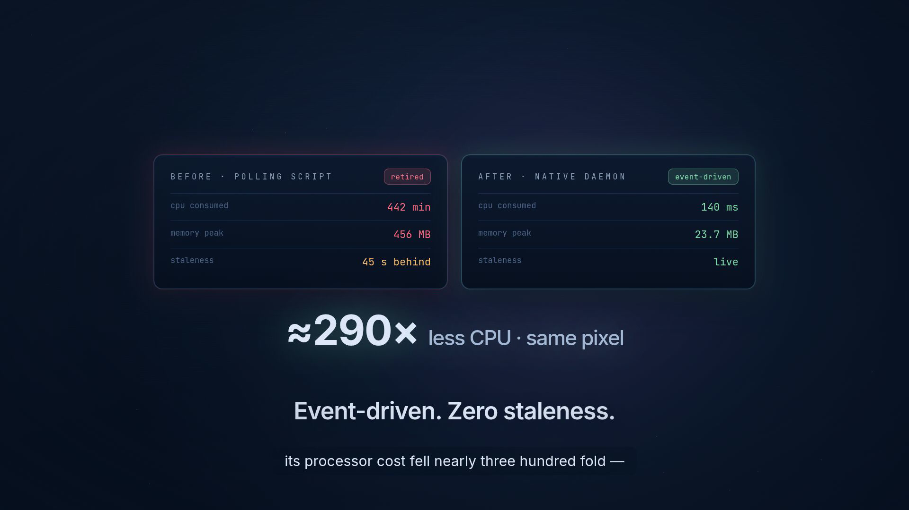

## Architecture

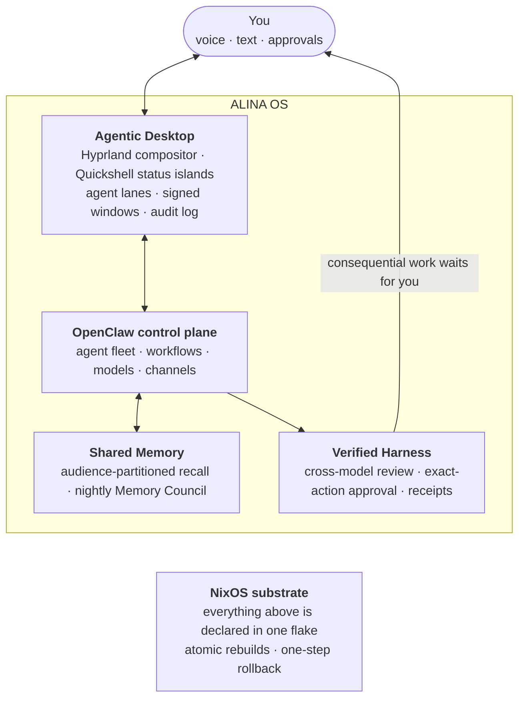

| Layer | What it does |
|---|---|
| **Agentic Desktop** | Hyprland compositor and Quickshell (QML) layer-shell surfaces. Resident daemons keep open sockets to the control plane instead of polling, so the status islands are live and near-zero cost. |
| **Shared Memory** | A memory service shared by every agent and coding harness, with audience-scoped recall that fails closed and a nightly multi-lab council for promotion into long-term knowledge. |
| **Verified Harness** | Cross-model review, blast-radius routing, frozen artifacts, exact-action approvals, execution receipts, and replay rejection. |
| **OpenClaw control plane** | Runs the agent fleet: specialist agents, workflow profiles, model routing across providers, and chat/voice channels. |
| **NixOS substrate** | A flake-pinned, declarative system with encrypted secrets, snapshot-backed state, and generation rollback. |

## Built with

NixOS (flakes, Home Manager) · Hyprland · Quickshell / QML · OpenClaw · ZFS · sops-nix ·
Node.js daemons · Claude, GPT, Gemini, and other frontier models · Remotion (for the film)

## Status

ALINA OS is in daily use as a working system, not a demo. The source is private
while the public distribution is being separated from personal and host-specific
configuration. Follow along at [alinaos.com](https://alinaos.com).

---

Built by <a href="https://controlstackai.com">ControlStackAI</a>. Film, screenshots,
and text © ControlStackAI. All rights reserved. The film uses synthetic demo data
throughout.
